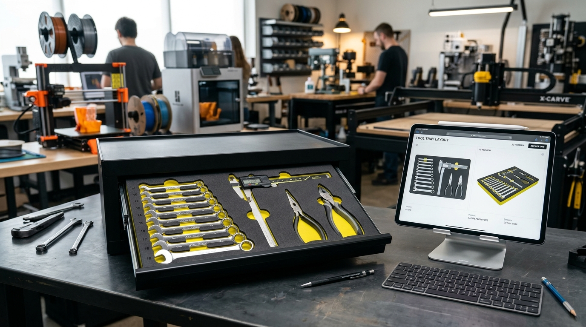
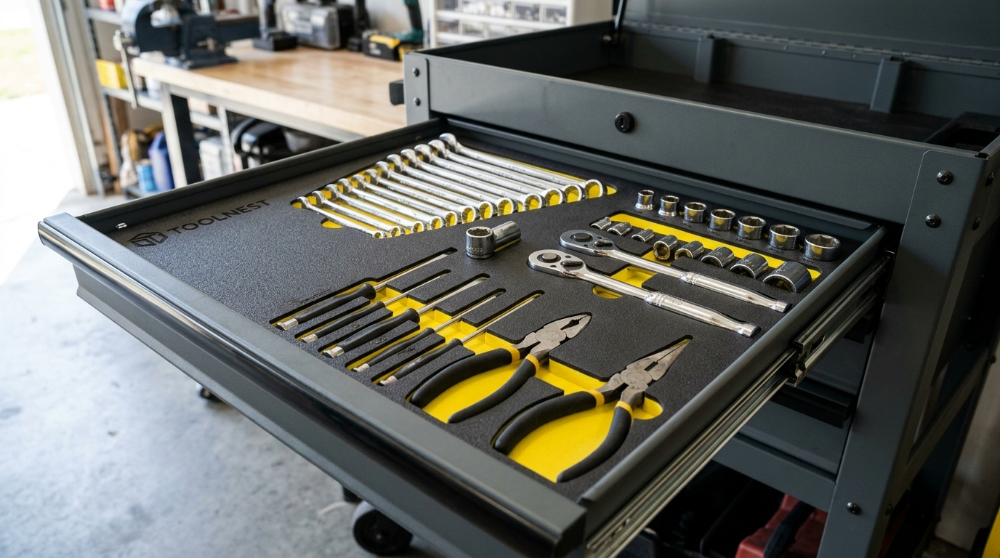
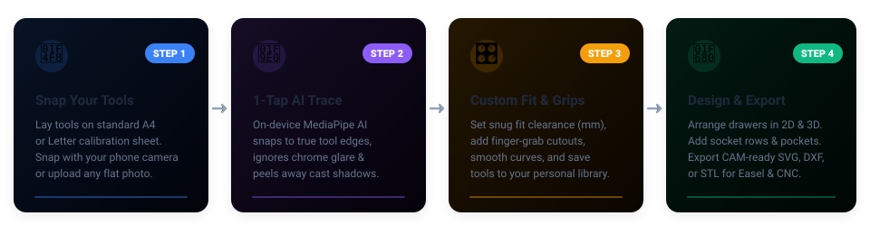
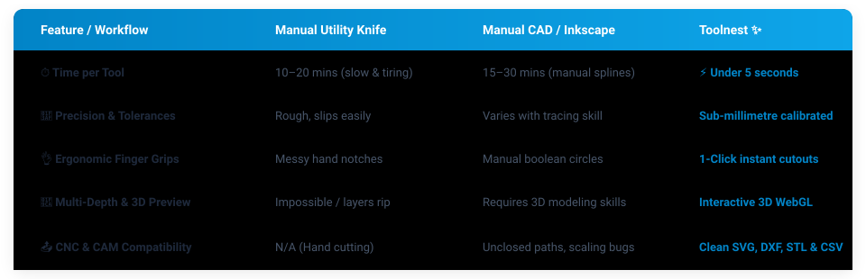

# ⌑ Toolnest

<p align="center">
  <a href="https://jggroot.github.io/toolnest/">
    
  </a>
</p>

<p align="center">
  <strong>From phone photo to precision CNC foam drawer inserts in seconds.</strong><br>
  No CAD expertise required. 100% private and runs entirely inside your web browser.
</p>

<p align="center">
  <a href="https://jggroot.github.io/toolnest/"></a>
  <a href="https://jggroot.github.io/toolnest/"></a>
</p>

<p align="center">
  
  
  
  
  
</p>

---

## ⚡ Why Toolnest?

Creating custom shadow foam (Kaizen foam) tool organizers used to mean two frustrating choices:
1. **Hours with a razor knife**: Uneven, jagged edges, ruined expensive foam, and sore fingers.
2. **Hours in CAD software**: Taking photos, dealing with perspective distortion, hand-tracing hundreds of bezier spline curves in Inkscape or Fusion 360, and guessing clearances.

**Toolnest automates the entire process:**
Place your hand tools on a sheet of paper, snap a photo with your phone, and let Toolnest's on-device AI extract crisp, sub-millimetre vector outlines in one click. Arrange them across your toolbox drawers, add finger grips and socket rows, preview the full depth in 3D, and export clean, CAM-ready toolpaths for your CNC router or 3D printer.

<p align="center">
  
</p>

---

## 🚀 Quick Start in 4 Easy Steps

<p align="center">
  
</p>

### 1. 📸 Snap Your Tools
- Print the free calibrated sheet (A4 or US Letter) right from the app.
- Lay your wrenches, ratchets, pliers, or calipers inside the border.
- Snap a photo using your smartphone or webcam. Toolnest's subpixel corner engine automatically corrects camera tilt and perspective distortion.

### 2. 🧠 1-Tap AI Trace
- Click any tool to trace it instantly using on-device machine learning (MediaPipe MagicTouch).
- Advanced shadow-peeling and chrome edge-snapping isolate the real physical tool boundary—ignoring reflections, specular highlights, and cast shadows.
- Need to touch up an edge? Use the **＋** and **−** refinement tools or fine-tune corner smoothing presets.

### 3. 🎛️ Custom Fit & Finger Grips
- Set your **Fit Clearance** (e.g. `+0.5 mm` for an easy drop-in fit or `-0.5 mm` for a friction press-fit).
- Click any edge to add ergonomic semi-circular finger-grab cutouts so tools pop out effortlessly.
- Save traced tools to your personal reusable tool library.

### 4. 🧰 Arrange & Export to CNC
- Switch to the **Foam** studio to lay out your toolbox drawers with snap-to-grid, auto-alignment, and spacing guides.
- Add multi-depth pockets (shallow jaws, deep handles) and generate instant socket rows.
- Inspect everything with the interactive **3D WebGL visualizer**.
- Export CAM-ready **SVG**, **DXF** (layered by depth), **3D STL**, or **CSV setup sheets** for your CNC machine.

---

## 📊 Toolnest vs Traditional Methods

<p align="center">
  
</p>

| Feature | Utility Knife &amp; Pick-and-Pluck | Manual CAD / Inkscape Tracing | Toolnest ✨ |
| :--- | :--- | :--- | :--- |
| **Speed** | 15–30 minutes per tool | 10–25 minutes of manual clicking | **Under 5 seconds per tool** |
| **Edge Precision** | Rough, wobbly cuts | Depends on operator patience | **Sub-millimetre algorithmic accuracy** |
| **Perspective Warping** | N/A | Hard to correct manually | **Automatic 16-point planar homography** |
| **Finger Grips** | Uneven hand notches | Tedious boolean difference ops | **1-Click continuous vector cutouts** |
| **Tiered Depths** | Hard to step cut evenly | Complex 3D CAD modeling required | **Interactive depth zones & 3D preview** |
| **CNC Compatibility** | None | Frequent unclosed loops & scaling errors | **Production-ready closed SVG / DXF / STL** |
| **Cost & Privacy** | Messy & waste prone | Steep learning curve | **100% Free, Open Source & Client-Side** |

---

## ✨ Features Built for Makers & Machinists

### 🧠 On-Device AI Segmentation (MediaPipe MagicTouch)
Toolnest runs modern vision models directly inside your web browser using WebAssembly and WebGL delegates:
- **No cloud servers**: Your workshop photos and tools remain 100% private to your machine.
- **Chrome & glare resistance**: Patented gradient-scoring distinguishes polished metal from paper glare.
- **Shadow peeling**: Automatically trims out soft ambient shadows and hard light casts up to 2.5 mm away from the true perimeter.

### 📐 Sub-Millimetre Calibration Engine
- Four 20 mm 8×8 coded fiducial markers eliminate perspective distortion even when taking photos at an angle.
- Automatic A4 and US Letter sheet detection.
- Optional 2-point ruler calibration for oversized tools or flatbed scanner direct imports (150+ DPI).

### 🧰 Full CAD Drawer Layout Studio
Designed with intuitive controls inspired by Fusion 360's sketch environment:
- **Snapping & Smart Guides**: Bounding boxes snap to drawer margins, center lines, and neighboring tools with collision warnings.
- **Parametric Shapes**: Add center rectangles, slots, circles, ellipses, and splines.
- **Automated Socket Rows**: Type a list of socket sizes (e.g. `10, 12, 14, 17@38, 19, 21`) to automatically generate a perfectly aligned, spaced row of socket pockets with custom depths.
- **Pocket Split & Erase**: Cut away unwanted sections or divide traced toolboxes into modular components.

### 🧊 Multi-Depth Pockets & Real-Time 3D WebGL Preview
- Draw multi-depth regions across any pocket (e.g., cut pliers handles at 18 mm depth and jaw tips at 8 mm depth).
- Real-time 3D rendering powered by Three.js lets you orbit, zoom, and inspect physical clearances and pocket depths before cutting into expensive foam.

### 📱 PWA & QR Code Phone Pairing
- Open Toolnest on your desktop or tablet.
- Click **Pair a phone** to generate a secure local QR code.
- Scan with your smartphone to immediately capture tools with your phone's camera—they sync directly to your desktop workspace in real-time.
- Installable as a Progressive Web App (PWA) on iOS Safari and Android Chrome for full-screen offline use.

### 🔄 Trace Existing Worn Foam Trays
- Have an existing two-color Kaizen foam tray that is worn out?
- Place it under the camera and use **Trace pockets** to automatically detect existing cutouts and rebuild an identical replacement CAD file.

---

## 🛠️ CAM & CNC Machine Compatibility

Toolnest produces clean, manifold, zero-defect vectors that import cleanly into your favorite CAM and CAD software without scaling surprises:

| Software / Machine | Recommended Format | Notes |
| :--- | :--- | :--- |
| **Inventables Easel &amp; Easel Pro** (X-Carve) | **SVG** or **STL** | Clean closed paths with 1:1 millimetre scale. Import SVG, set pocket depths from the Toolnest CSV setup sheet, or import STL directly in Easel Pro. |
| **Carbide Create** (Shapeoko) | **SVG** / **DXF** | Closed vector geometry imports directly into design layers with exact dimensions. |
| **Vectric VCarve / Aspire** | **DXF** | Organizes pockets into distinct `DEPTH_*_MM` layers for fast automated toolpath templates. |
| **Fusion 360 / Carveco** | **DXF** / **STL** | Clean geometry imports without duplicate vertices or self-intersecting loops. |
| **3D Printers** (Bambu, Prusa, Creality) | **STL** | Exports a watertight, solid 3D mesh ready to drop into Bambu Studio, OrcaSlicer, or PrusaSlicer for printing custom TPU or PLA tool holders. |
| **Manual Hand Cutting** | **1:1 PDF** | Print full-scale 1:1 paper templates to glue onto foam for razor-guided hand cuts. |

---

## 💡 Pro Tips for Perfect Foam Cuts

1. **Lighting**: Use diffuse room lighting or natural daylight when photographing tools. Avoid harsh single-point flash that casts sharp shadows.
2. **Endmills**: For cutting polyurethane or polyethylene Kaizen foam on a CNC router, use a **spiral downcut bit** or dedicated foam bit (1/8" or 1/4" single-flute) at high RPM (16,000–18,000 RPM) to keep top foam edges crisp and fuzz-free.
3. **Fit Tolerances**:
   - `+0.5 mm` to `+1.0 mm`: Standard comfortable fit (tools slide in and out easily).
   - `0.0 mm`: Snug fit (best when paired with finger cutouts).
   - `-0.5 mm`: Tight friction hold (great for vertical tool walls or mobile toolboxes).
4. **1:1 Screen Check**: Use the **1:1 button** in the layout editor and hold your physical tool up against the monitor to verify scale before machining.

---

## ❓ Frequently Asked Questions (FAQ)

<details>
<summary><strong>Is Toolnest really free?</strong></summary>
Yes! Toolnest is 100% free and open-source software under the MIT license. There are no paywalls, subscriptions, or export watermarks.
</details>

<details>
<summary><strong>Do I need a CNC machine or 3D printer?</strong></summary>
No. While Toolnest is built for CNC routers and 3D printers, you can also print 1:1 scale paper templates to lay directly over your foam and guide manual utility knife cuts with precision.
</details>

<details>
<summary><strong>Are my photos or workshop data uploaded to a server?</strong></summary>
No. All image processing, perspective calibration, AI edge segmentation, and CAD calculations occur 100% locally in your browser using WebAssembly. Your photos never leave your device.
</details>

<details>
<summary><strong>What paper sizes are supported for the calibration sheet?</strong></summary>
Standard **A4** (210 × 297 mm) and **US Letter** (8.5 × 11 in). Toolnest automatically detects which sheet you printed based on the fiducial markers.
</details>

<details>
<summary><strong>Can I use tools that are larger than a single sheet of paper?</strong></summary>
Yes! For oversized tools, use the foam background alignment mode with a measured reference ruler, or stitch multiple sheets.
</details>

---

## 💻 Developer & Self-Hosting Guide

Toolnest is built with vanilla modern web standards—no heavy build steps, Webpack, or npm runtime dependencies are required to run the frontend.

### Quick Local Development

1. **Clone the repository**:
   ```bash
   git clone https://github.com/JGGroot/Toolnest.git
   cd Toolnest
   ```

2. **Start the local server**:
   ```bash
   npm start
   ```
   Open your browser to `http://localhost:3000`.

3. **Run the test suite**:
   ```bash
   npm test
   ```
   Runs the complete unit and algorithmic test suite covering perspective math, marker dictionary separation, edge-snapping, contour smoothing bounds, and STL mesh closure.

For deployment options, GitHub Actions configuration, and database schemas for optional multi-device cloud synchronization, see [DEPLOY.md](DEPLOY.md).

---

<p align="center">
  Crafted with care for makers, machinists, and organizers everywhere.<br>
  <strong><a href="https://jggroot.github.io/toolnest/">Launch Toolnest Live →</a></strong>
</p>
